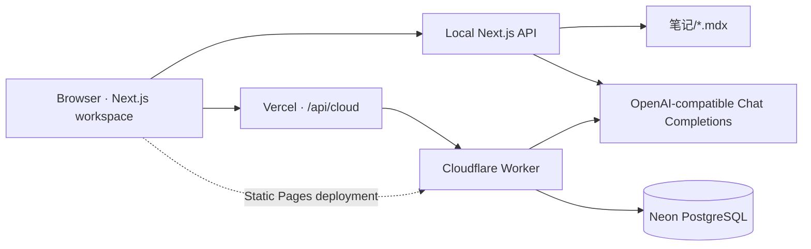

<a id="readme-top"></a>

<div align="center">
  
  <h1>YYNotes</h1>
  <p><strong>Turn source material into bilingual notes you can read, edit, and study.</strong></p>
  <p>An AI workspace for courses, reading, research, exam revision, and everyday learning.</p>
  <p><strong>English</strong> · <a href="README.zh-CN.md">简体中文</a></p>
  <p>
    <a href="https://yynotes.yanyihan.top">Open website</a> ·
    <a href="#quick-start">Quick start</a> ·
    <a href="docs/DEPLOYMENT.md">Deployment guide</a> ·
    <a href="https://github.com/YanYihann/YYnotes/issues">Report an issue</a>
  </p>
</div>


## Overview

YYNotes brings note generation, organization, reading, editing, and contextual AI assistance into one workspace. Paste text or upload a document, generate a structured Chinese-first note with an aligned **English Version**, and continue working with the result as Markdown stored in `.mdx` files or in cloud storage.

The interface defaults to English and supports switching to Chinese. The interface language and the Chinese-first generation format serve different purposes: switching the interface does not rewrite your saved notes.

The project is a general-purpose knowledge workspace. Formula rendering and numerical demos are available when useful, alongside support for prose, code, tables, and research material.

<details>
<summary>Contents</summary>

- [Features](#features)
- [Preview](#preview)
- [Architecture](#architecture)
- [Quick start](#quick-start)
- [Configuration](#configuration)
- [Using the workspace](#using-the-workspace)
- [Routes and APIs](#routes-and-apis)
- [Development](#development)
- [Deployment](#deployment)
- [Repository map](#repository-map)
- [Current limits and roadmap](#current-limits-and-roadmap)
- [Contributing](#contributing)
- [License and credits](#license-and-credits)

</details>

## Features

| Area | What you can do |
| --- | --- |
| Source material | Paste text or extract text from TXT, Markdown, DOCX, PPTX, text-based PDF, TeX, and CSV files. |
| Bilingual generation | Generate Chinese-first notes and an English Version with matching structure, following `prompt.md`. |
| Reading | Read headings, tables, highlighted code, images, and KaTeX formulas with a table of contents and language controls. |
| Editing | Edit note content and metadata; add clearly marked annotations without replacing the original passage. |
| Study assistant | Ask questions grounded in the current note or selected text, with streamed responses and question history. |
| Organization | Search and filter notes, manage cloud folders, import Markdown/MDX, and move notes to or restore them from Trash. |
| Cloud accounts | Sign in with email/password or Google; access user-isolated notes and cloud highlights. |
| Interface | Switch between English and Chinese, use light/dark themes, and work on desktop or mobile browsers. |
| Interactive content | Explore the included numerical demos and supported note-embedded interactive components. |

## Preview

The screenshots below show the local production build with public example notes and no signed-in account.


<details>
<summary>Reading workspace and study assistant</summary>


</details>

## Architecture



| Mode | Storage | Setup |
| --- | --- | --- |
| Local | `.mdx` files in `笔记/`; local Trash uses `笔记回收站/` | Run Next.js locally. Configure a server-side provider key for AI features. |
| Cloud | Authenticated notes, folders, and highlights in Neon | Deploy the Worker and configure the frontend API base. |
| Vercel frontend | Public examples are read-only; personal notes use cloud storage | Use the same-origin `/api/cloud` proxy to the Worker. |
| Static frontend | Public examples are exported; personal notes use the Worker directly | Set `DEPLOY_TARGET=cloudflare-pages` and an absolute Worker API URL. |

## Quick start

Use **Node.js 22 LTS or newer** and npm. A provider key is needed for generation and AI assistance; browsing bundled example notes does not need one.

```bash
git clone https://github.com/YanYihann/YYnotes.git
cd YYnotes
npm ci
```

Copy `.env.example` to `.env.local` using your editor or file manager, then set `OPENAI_API_KEY`. Leave the cloud variables empty for local mode.

```bash
npm run dev
```

Open [localhost:3000](http://localhost:3000). For a production build, run `npm run build` followed by `npm start`.

## Configuration

The frontend example is [.env.example](.env.example). Worker setup and database initialization are described in the [deployment guide](docs/DEPLOYMENT.md).

| Variable | Where | Purpose |
| --- | --- | --- |
| `OPENAI_API_KEY` | Local Next.js server / Worker secret | AI provider credential. Never use a `NEXT_PUBLIC_` prefix. |
| `OPENAI_BASE_URL` | Local server / Worker configuration | Chat Completions base URL; current code defaults to `https://api.302.ai/v1`. |
| `OPENAI_MODEL` | Local server / Worker configuration | Current default: `deepseek-v3.2`. Generation also validates supported model names. |
| `OPENAI_ASSISTANT_MODEL` | Local Next.js server | Optional assistant model override; falls back to `OPENAI_MODEL`. |
| `NEXT_PUBLIC_NOTES_API_BASE` | Frontend, at build time | Empty for local mode; `/api/cloud` on Vercel; absolute Worker URL for static hosting. |
| `NOTES_UPSTREAM_URL` | Vercel server | Worker origin behind `/api/cloud`, without a trailing slash. |
| `NEXT_PUBLIC_GOOGLE_CLIENT_ID` | Frontend, at build time | Optional Google OAuth web client ID; match the Worker's `GOOGLE_CLIENT_ID`. |
| `DATABASE_URL`, `AUTH_SECRET` | Worker secrets | Neon connection string and authentication signing secret. |
| `ALLOWED_ORIGIN` | Worker configuration | Comma-separated frontend origins for direct browser access. |
| `DEPLOY_TARGET` | Build environment | Leave unset for Vercel/local server; `cloudflare-pages` for static export. |

The main composer currently offers **DeepSeek V3.2**. Changing an environment variable alone does not add a new model to the interface or bypass the generation allowlist.

## Using the workspace

1. Paste source text or select a supported document on the homepage.
2. Add an optional title and instructions, then generate a note. Sign in first when cloud mode is enabled.
3. Read the result and switch the interface language as needed.
4. Edit the note, update its metadata, or add an annotation. Ask the study assistant about the note or a selected passage.
5. Organize cloud notes into folders, import existing Markdown/MDX, or restore deleted notes from Trash.

**Authoring rules.** `prompt.md` is the default generation source; `prompt2.md` supplies the detailed preset used by the extended generator. Their copies under `public/` synchronize automatically before development and builds. Keep Chinese and English sections structurally aligned, preserve relevant source details, and use KaTeX-safe math. Ordinary Markdown saved as `.mdx` is sufficient; arbitrary MDX expressions are not a general execution interface.

## Routes and APIs

| Page | Purpose |
| --- | --- |
| `/` | Generation workspace and note library preview |
| `/auth` | Email/password and Google sign-in |
| `/notes` | Library, imports, folders, and Trash |
| `/notes/[slug]` | Local/public note reader |
| `/notes/cloud?slug=...` | Authenticated cloud note reader/editor |
| `/demos` | Interactive demo index, including integration, differentiation, and Romberg demos |
| `/demos/sign-in` | Sign-in component demo |

| API | Purpose |
| --- | --- |
| `POST /api/note-generator` | Generate and save a local note |
| `POST /api/notes-assistant` | Local contextual assistant |
| `GET /api/notes` | Local note/Trash listing |
| `POST /api/notes` | Import, restore, or refresh import metadata via the relevant `action` |
| `PATCH /api/notes?slug=...` | Update local content or metadata |
| `DELETE /api/notes?slug=...` | Move a note to Trash or permanently delete with the relevant query options |
| `POST /api/cloud/notes/generate` | Vercel generation proxy with authentication-header and payload checks |

The Worker exposes `/auth/*`, `/notes*`, `/folders*`, `/assistant`, and `/health`. Cloud note routes include generation, import metadata, Trash restoration, and highlights. Protected endpoints require `Authorization: Bearer <token>`; see the [Worker README](cloud/neon-notes-worker/README.md).

Local filesystem mutation and browser automation endpoints are workstation features. Vercel cloud deployments block those local endpoints through middleware.

## Development

| Command | Purpose |
| --- | --- |
| `npm run dev` | Start the development server and synchronize prompts |
| `npm run typecheck` | Check TypeScript |
| `npm run lint` | Run the repository's current Next.js lint command |
| `npm run test:generation` | Check extraction, cancellation, request sizes, and generation proxy handling |
| `npm run test:provider` | Check Worker auth, provider errors, bilingual saves, and streamed assistance |
| `npm run build` | Synchronize prompts and build for the selected deployment target |
| `npm start` | Serve the standard production build |

The generation/provider tests use synthetic files, mocked transport, and a simulated database. They do not require a real AI key or create live notes. `next lint` is deprecated upstream; lint migration is a maintenance item.

## Deployment

The frontend and Worker deploy separately. The current frontend setup uses **Vercel → Cloudflare Worker → Neon**, while the repository also retains a Cloudflare Pages static-export workflow.

Follow [docs/DEPLOYMENT.md](docs/DEPLOYMENT.md) for environment variables, Neon schema setup, Worker secrets, CORS, Vercel configuration, and GitHub Actions. Pushing relevant files to `master` can trigger the existing Pages and Worker deployment workflows when repository credentials are configured.

## Repository map

```text
YYnotes/
├── app/                         # Next.js pages, styles, icons, and local/proxy APIs
├── components/                  # Workspace, reading/editing, auth, AI, and demos
├── lib/                         # Content, bilingual rendering, auth, and AI clients
├── cloud/neon-notes-worker/      # Worker API, schema, configuration, and lockfile
├── functions/api/               # Cloudflare Pages Functions
├── 笔记/                        # Bundled/local Markdown notes stored as .mdx
├── public/                      # Prompt copies, fonts, textures, and PDF worker
├── scripts/                     # Build/prompt utilities and regression tests
├── docs/                        # Deployment documentation
├── .github/workflows/           # Pages and Worker deployment
├── .env.example                 # Safe frontend/local configuration example
├── prompt.md / prompt2.md       # Generation instructions
├── DESIGN.md                    # Interface design rules
├── README.md                    # English documentation (default)
└── README.zh-CN.md              # Chinese documentation
```

Dependency directories, generated builds, browser profiles, local environment files, and development secrets are excluded from the published source tree. Dependency lockfiles and required runtime assets are included.

## Current limits and roadmap

- The homepage extracts text from documents; scanned PDFs require OCR first. Direct image/OCR generation is not part of this entry point.
- The generation proxy accepts files up to **4 MiB**, reserves multipart overhead, and rejects extracted source text over **35,000 characters** without silently truncating it.
- Cancelling preparation stops local processing. After submission, a timeout or interruption can leave the save outcome uncertain: check the library before retrying. Requests do not retry automatically.
- Text drafts and settings persist on the device; selected files need to be reselected after sign-in or a reload.
- Cloud notes reside in Neon, not in this Git repository. Uploading source code does not export accounts or cloud note content.

Planned improvements:

- [ ] Complete speech-to-text processing for voice attachments.
- [ ] Expand reusable note blocks and interactive examples across subjects.
- [ ] Add a broader screenshot gallery and accessibility checks.
- [ ] Migrate the deprecated Next.js lint entry point.

## Contributing

Open an [issue](https://github.com/YanYihann/YYnotes/issues) with reproduction steps or a feature proposal. For changes, fork the repository, create a branch, and submit a pull request with relevant validation. Follow [AGENTS.md](AGENTS.md) for product/content rules and [DESIGN.md](DESIGN.md) for interface changes.

## License and credits

No project-wide `LICENSE` file is currently included. This README does not grant an additional software license. Bundled third-party assets retain their own terms, including the [DM Sans font license](public/fonts/OFL-DM-Sans.txt).

The documentation adapts the project/installation/usage structure of [Best-README-Template](https://github.com/othneildrew/Best-README-Template) and the clear presentation and navigation patterns collected in [awesome-readme](https://github.com/matiassingers/awesome-readme).

Built with Next.js, React, TypeScript, Tailwind CSS, Radix UI/shadcn conventions, React Markdown, KaTeX, PDF.js, JSZip, Cloudflare Workers, and Neon.

Maintained by [YanYihann](https://github.com/YanYihann) · [Project repository](https://github.com/YanYihann/YYnotes)

<p align="right"><a href="#readme-top">Back to top ↑</a></p>
