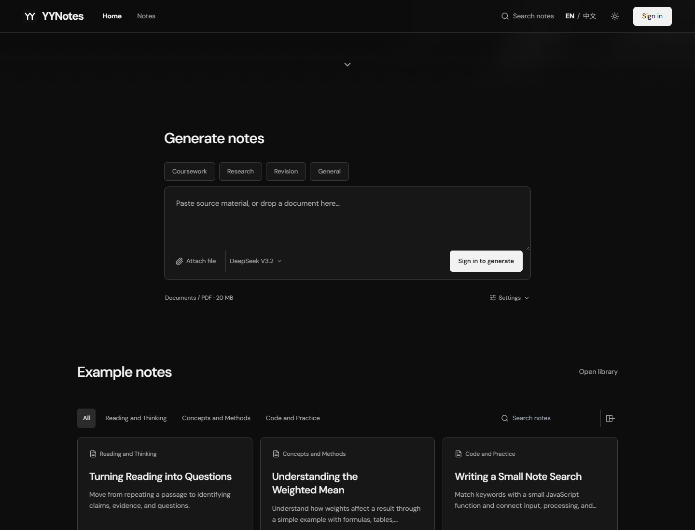
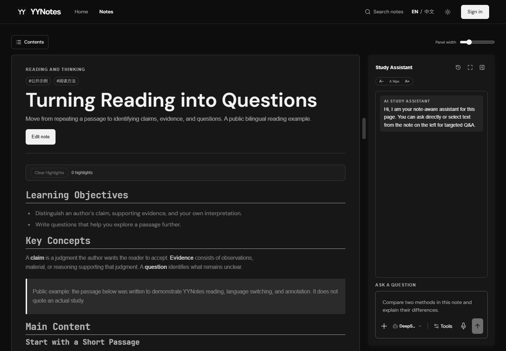
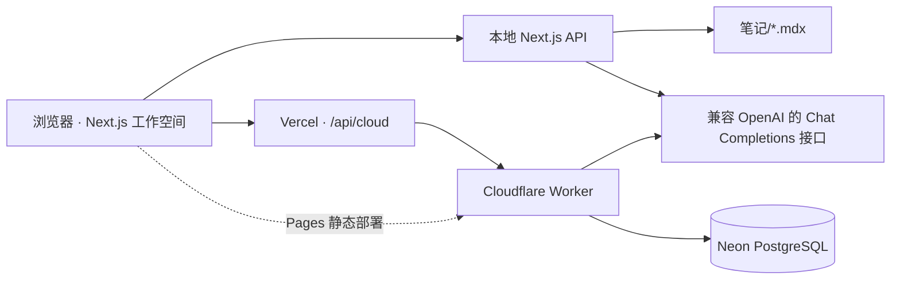

<a id="readme-top"></a>

<div align="center">
  
  <h1>YYNotes</h1>
  <p><strong>把原始资料整理成可以阅读、编辑与追问的中英双语笔记。</strong></p>
  <p>面向课程学习、阅读、研究、考试复习与日常知识整理的 AI 工作空间。</p>
  <p><a href="README.md">English</a> · <strong>简体中文</strong></p>
  <p>
    <a href="https://yynotes.yanyihan.top">打开网页版</a> ·
    <a href="#quick-start">快速开始</a> ·
    <a href="docs/DEPLOYMENT.md">部署指南</a> ·
    <a href="https://github.com/YanYihann/YYnotes/issues">反馈问题</a>
  </p>
</div>


## 项目介绍

YYNotes 将笔记生成、整理、阅读、编辑和上下文 AI 问答整合在同一工作空间。粘贴文字或上传文档，即可生成中文优先、附带结构对应的 **English Version** 的笔记，再以 `.mdx` 文件或云端数据的形式继续管理。

界面默认使用英文，可切换到中文。界面语言与笔记生成格式分别控制：切换界面语言不会改写已保存的笔记。

项目适用于不同学科和知识领域。公式渲染和数值计算演示用于有需要的内容，同时兼顾长文、代码、表格与研究资料。

<details>
<summary>目录</summary>

- [功能概览](#features)
- [界面预览](#preview)
- [系统架构](#architecture)
- [快速开始](#quick-start)
- [环境配置](#configuration)
- [使用流程](#usage)
- [页面与接口](#routes)
- [开发与验证](#development)
- [部署方式](#deployment)
- [项目目录](#structure)
- [当前限制与后续计划](#roadmap)
- [参与贡献](#contributing)
- [许可与致谢](#credits)

</details>

<a id="features"></a>

## 功能概览

| 模块 | 能力 |
| --- | --- |
| 资料输入 | 粘贴文字，或提取 TXT、Markdown、DOCX、PPTX、文字型 PDF、TeX、CSV 中的文本。 |
| 双语生成 | 遵循 `prompt.md`，生成中文优先、英文结构对应的笔记。 |
| 阅读 | 展示标题、表格、代码高亮、图片与 KaTeX 公式，提供目录和语言控制。 |
| 编辑 | 编辑正文与元数据；批注采用明确标记的引用块，保留原始段落。 |
| 学习助手 | 围绕当前笔记或选中文字进行问答，支持流式响应与提问历史。 |
| 笔记整理 | 搜索筛选、云端文件夹、Markdown/MDX 导入、回收站与恢复。 |
| 云端账号 | 邮箱密码或 Google 登录，按用户隔离笔记，支持云端高亮。 |
| 界面 | 中英文切换、明暗主题以及桌面和手机浏览器适配。 |
| 交互内容 | 内置数值计算演示，以及支持的笔记内嵌交互组件。 |

<a id="preview"></a>

## 界面预览

以下截图来自本地生产构建，展示未登录状态和公开示例笔记。



<details>
<summary>阅读工作区与学习助手</summary>



</details>

<a id="architecture"></a>

## 系统架构



| 模式 | 存储 | 配置方式 |
| --- | --- | --- |
| 本地模式 | `笔记/` 中的 `.mdx` 文件；本地回收站为 `笔记回收站/` | 本机运行 Next.js；AI 功能需配置服务端密钥。 |
| 云端模式 | Neon 中按用户保存的笔记、文件夹和高亮 | 部署 Worker 并配置前端 API 地址。 |
| Vercel 前端 | 公开示例只读，个人笔记使用云端存储 | 通过同源 `/api/cloud` 代理访问 Worker。 |
| 静态前端 | 导出公开示例，个人笔记直接访问 Worker | 设置 `DEPLOY_TARGET=cloudflare-pages` 和绝对 Worker 地址。 |

<a id="quick-start"></a>

## 快速开始

建议使用 **Node.js 22 LTS 或更新版本**及 npm。生成与 AI 问答需要模型服务密钥；浏览内置示例笔记无需密钥。

```bash
git clone https://github.com/YanYihann/YYnotes.git
cd YYnotes
npm ci
```

使用编辑器或文件管理器将 `.env.example` 复制为 `.env.local`，填写 `OPENAI_API_KEY`。本地模式下将云端配置留空。

```bash
npm run dev
```

打开 [localhost:3000](http://localhost:3000)。运行生产版本时，先执行 `npm run build`，再执行 `npm start`。

<a id="configuration"></a>

## 环境配置

前端配置示例见 [.env.example](.env.example)。Worker 配置及数据库初始化步骤见[部署指南](docs/DEPLOYMENT.md)。

| 变量 | 配置位置 | 用途 |
| --- | --- | --- |
| `OPENAI_API_KEY` | 本地 Next.js 服务端／Worker Secret | 模型服务密钥，不得使用 `NEXT_PUBLIC_` 前缀。 |
| `OPENAI_BASE_URL` | 本地服务端／Worker 配置 | Chat Completions 接口地址；当前代码默认 `https://api.302.ai/v1`。 |
| `OPENAI_MODEL` | 本地服务端／Worker 配置 | 当前默认 `deepseek-v3.2`；生成接口还会校验支持的模型名称。 |
| `OPENAI_ASSISTANT_MODEL` | 本地 Next.js 服务端 | 可选助手模型，未设置时回退至 `OPENAI_MODEL`。 |
| `NEXT_PUBLIC_NOTES_API_BASE` | 前端构建环境 | 本地留空；Vercel 使用 `/api/cloud`；静态站点使用完整 Worker 地址。 |
| `NOTES_UPSTREAM_URL` | Vercel 服务端 | `/api/cloud` 代理的 Worker 来源地址，不带末尾斜杠。 |
| `NEXT_PUBLIC_GOOGLE_CLIENT_ID` | 前端构建环境 | 可选 Google OAuth 网页客户端 ID，与 Worker 的 `GOOGLE_CLIENT_ID` 对应。 |
| `DATABASE_URL`、`AUTH_SECRET` | Worker Secrets | Neon 连接串和身份令牌签名密钥。 |
| `ALLOWED_ORIGIN` | Worker 配置 | 允许直接访问 API 的前端来源，以逗号分隔。 |
| `DEPLOY_TARGET` | 构建环境 | Vercel／本地服务不设置；静态导出使用 `cloudflare-pages`。 |

主生成入口目前提供 **DeepSeek V3.2**。只修改环境变量不会自动增加界面中的模型，也不会绕过生成接口的模型白名单。

<a id="usage"></a>

## 使用流程

1. 在首页粘贴资料文字或选择支持的文档。
2. 按需填写标题与附加要求，生成笔记。启用云端模式后需先登录。
3. 阅读结果，按需要切换界面语言。
4. 编辑正文和元数据，或添加批注；向学习助手追问笔记或选中文字。
5. 将云端笔记归入文件夹、导入已有 Markdown/MDX，或从回收站恢复笔记。

**内容规则。** `prompt.md` 为默认生成规则，`prompt2.md` 为扩展生成器使用的详细预设。开发和构建前会自动同步到 `public/`。中英文结构应保持对应，保留重要资料细节，公式应兼容 KaTeX。普通 Markdown 保存为 `.mdx` 即可；任意 MDX 表达式不是通用执行入口。

<a id="routes"></a>

## 页面与接口

| 页面 | 用途 |
| --- | --- |
| `/` | 生成工作区与笔记库预览 |
| `/auth` | 邮箱密码与 Google 登录 |
| `/notes` | 笔记库、导入、文件夹与回收站 |
| `/notes/[slug]` | 本地／公开笔记阅读 |
| `/notes/cloud?slug=...` | 登录后的云端笔记阅读与编辑 |
| `/demos` | 积分、微分、Romberg 等交互演示索引 |
| `/demos/sign-in` | 登录组件演示 |

| 接口 | 用途 |
| --- | --- |
| `POST /api/note-generator` | 生成并保存本地笔记 |
| `POST /api/notes-assistant` | 本地上下文问答 |
| `GET /api/notes` | 列出本地笔记或回收站内容 |
| `POST /api/notes` | 根据对应 `action` 导入、恢复笔记或更新导入元数据 |
| `PATCH /api/notes?slug=...` | 修改本地正文或元数据 |
| `DELETE /api/notes?slug=...` | 移入回收站，或通过对应查询参数永久删除 |
| `POST /api/cloud/notes/generate` | Vercel 生成代理，检查身份头和请求大小 |

Worker 提供 `/auth/*`、`/notes*`、`/folders*`、`/assistant` 和 `/health`。云端笔记接口涵盖生成、导入元数据、回收站恢复与高亮；受保护接口需要 `Authorization: Bearer <token>`，详见 [Worker README](cloud/neon-notes-worker/README.md)。

本地文件修改和浏览器自动化接口供本机工作站使用。Vercel 云端部署通过中间件阻止访问这些本地接口。

<a id="development"></a>

## 开发与验证

| 命令 | 用途 |
| --- | --- |
| `npm run dev` | 同步 Prompt 并启动开发服务 |
| `npm run typecheck` | TypeScript 类型检查 |
| `npm run lint` | 执行当前仓库的 Next.js lint 命令 |
| `npm run test:generation` | 验证文件提取、取消、请求大小及生成代理 |
| `npm run test:provider` | 验证 Worker 身份校验、模型错误、双语保存与流式问答 |
| `npm run build` | 同步 Prompt，并按部署目标构建 |
| `npm start` | 运行标准生产构建 |

生成和模型接口测试使用合成文件、模拟网络和模拟数据库，无需真实 AI 密钥，也不创建线上笔记。上游已弃用 `next lint`，迁移入口属于后续维护事项。

<a id="deployment"></a>

## 部署方式

前端与 Worker 分别部署。当前前端配置采用 **Vercel → Cloudflare Worker → Neon**，仓库也保留 Cloudflare Pages 静态导出工作流。

完整步骤见 [docs/DEPLOYMENT.md](docs/DEPLOYMENT.md)，涵盖环境变量、Neon 建表、Worker Secrets、CORS、Vercel 与 GitHub Actions。仓库配置好凭据后，向 `master` 推送对应文件会触发已有 Pages／Worker 部署工作流。

<a id="structure"></a>

## 项目目录

```text
YYnotes/
├── app/                         # Next.js 页面、样式、图标及本地／代理接口
├── components/                  # 工作区、阅读编辑、账号、AI 与演示组件
├── lib/                         # 内容处理、双语渲染、身份及 AI 客户端
├── cloud/neon-notes-worker/      # Worker API、数据库结构、配置及锁文件
├── functions/api/               # Cloudflare Pages Functions
├── 笔记/                        # 内置／本地笔记，以 .mdx 保存
├── public/                      # Prompt 副本、字体、纹理和 PDF Worker
├── scripts/                     # 构建、Prompt 同步与回归测试
├── docs/                        # 部署文档
├── .github/workflows/           # Pages 和 Worker 部署
├── .env.example                 # 不含真实密钥的配置示例
├── prompt.md / prompt2.md       # 生成规则
├── DESIGN.md                    # 界面设计规范
├── README.md                    # 英文文档，默认入口
└── README.zh-CN.md              # 中文文档
```

上传内容排除依赖目录、构建产物、浏览器配置、本地环境文件与开发密钥，保留依赖锁文件和运行所需的静态资源。

<a id="roadmap"></a>

## 当前限制与后续计划

- 首页使用文档文本提取；扫描型 PDF 需先 OCR。此入口不提供直接图片识别生成。
- 生成代理允许最大 **4 MiB** 的文件，并为 multipart 请求预留空间；提取文字超过 **35,000 字符**时会报错，不静默截断。
- 准备阶段可取消本地处理。提交后超时或断线可能无法确认是否已保存，应先查看笔记库再重试；请求不会自动重试。
- 文字草稿与设置保存在设备上；登录或刷新后需要重新选择附件。
- 云端笔记存储在 Neon，上传源码不会导出账号或云端笔记数据。

后续计划：

- [ ] 完整接入语音附件转文字流程。
- [ ] 扩展跨学科的可复用笔记块与交互示例。
- [ ] 补充更多界面截图与无障碍检查。
- [ ] 迁移已弃用的 Next.js lint 入口。

<a id="contributing"></a>

## 参与贡献

欢迎通过 [Issue](https://github.com/YanYihann/YYnotes/issues) 提供复现步骤或功能建议。修改代码时可 Fork 仓库、创建分支，再提交包含相关验证结果的 Pull Request。产品及内容规则见 [AGENTS.md](AGENTS.md)，界面修改遵循 [DESIGN.md](DESIGN.md)。

<a id="credits"></a>

## 许可与致谢

当前未包含项目级 `LICENSE` 文件，此文档不额外授予软件许可。第三方资源遵循各自许可，包括 [DM Sans 字体许可](public/fonts/OFL-DM-Sans.txt)。

文档采用 [Best-README-Template](https://github.com/othneildrew/Best-README-Template) 的项目介绍、安装与使用结构，并参考 [awesome-readme](https://github.com/matiassingers/awesome-readme) 收录的清晰展示与导航方式。

项目使用 Next.js、React、TypeScript、Tailwind CSS、Radix UI／shadcn 约定、React Markdown、KaTeX、PDF.js、JSZip、Cloudflare Workers 和 Neon。

维护者：[YanYihann](https://github.com/YanYihann) · [项目仓库](https://github.com/YanYihann/YYnotes)

<p align="right"><a href="#readme-top">返回顶部 ↑</a></p>
